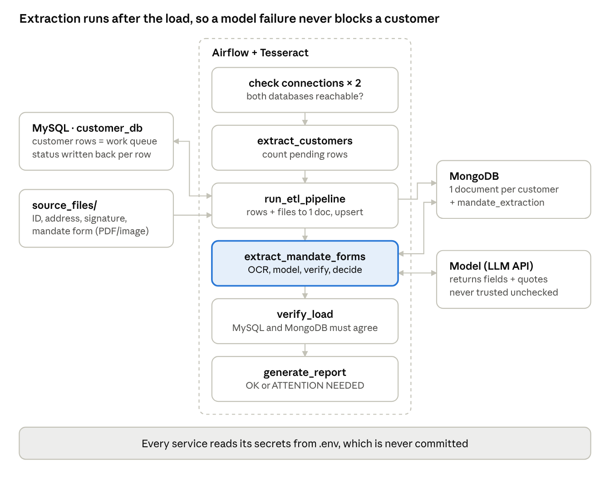
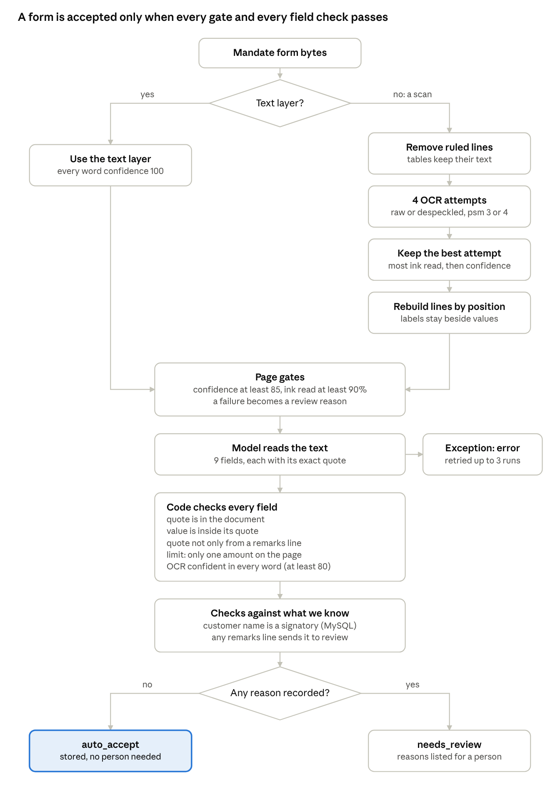

# Customer Mandate ETL with Verified Form Extraction

A containerised pipeline that moves customer mandate records from MySQL to MongoDB with their supporting documents, then reads each customer's account mandate form and turns it into verified, structured data. Apache Airflow schedules and monitors every run.

The rule behind the extraction: **a model's answer is a claim, and code checks every claim.** Anything the code cannot verify goes to a person. Nothing is guessed.

> All customers, documents and amounts in this repository are synthetic. Every generated form is stamped SPECIMEN.

---

## Why it was built

Customer records are only as good as their data entry. Fields get left blank, mistyped or never captured, while the documents that hold the facts, above all the account mandate, sit in storage as files nobody reads.

This project reads them. Each mandate is turned into verified fields stored beside the customer's record. For existing customers, that recovers information that only lived on paper: who may sign, under what rule, and up to what daily limit. For new customers, the record is checked against their own form from the start, and a mismatch, such as a customer name that is not among the signatories, is flagged instead of stored silently.

## How it works

Code reads the document's text first: straight from the PDF when it has a text layer, or by OCR when it is a scan. A language model then interprets that text and returns each field with the exact words it came from. Finally, code checks the model's answer against the text it already has. **It does not predict the model's answer; it validates the answer after it arrives.** A form passes only when every check passes; otherwise it goes to review with the reasons listed.





---

## Tools

| Tool | Version | Role |
|---|---|---|
| Docker Compose | – | Six services on one network, with health checks and named volumes |
| MySQL | 8.0 | Source database `customer_db`; the `customer_mandates` table is also the work queue |
| MongoDB | 7.0 | Target: one document per customer with embedded files and the extraction result |
| Apache Airflow | 2.8.1 | Schedules and runs the 7-task DAG hourly (LocalExecutor) |
| PostgreSQL | 13 | Airflow's own metadata database; not part of the data flow |
| Mongo Express | latest | Browser view of MongoDB |
| Tesseract OCR | 5.3.0 (in the image) | Reads text from scanned forms |
| Anthropic API (`claude-haiku-5-5`) | SDK 0.40.0 | Extracts fields with quotes; configurable with `MANDATE_MODEL` |
| Python | 3.11 | Pipeline, extractor, tests; PyMySQL, PyMongo, pypdf, pypdfium2, pytesseract, numpy, Pillow, ReportLab |

## Services

| Service | Container | Host port | Notes |
|---|---|---|---|
| mysql | mysql_source | **3307** | Runs `mysql/init/*.sql` on first start. 3307 avoids clashing with a local MySQL on 3306 |
| mongodb | mongodb_target | 27017 | Root user authentication |
| mongo-express | mongo_express | 8082 | Local only, no login |
| postgres | airflow_postgres | – | Internal |
| airflow-webserver | airflow_webserver | 8081 | Built from `Dockerfile` (Airflow + Tesseract) |
| airflow-scheduler | airflow_scheduler | – | Runs the DAG |

Every secret is read from `.env`, which is never committed. `.env.example` lists the names.

## The DAG

`customer_mandate_etl` runs every hour, without catch-up.

| Task | What it does |
|---|---|
| `check_mysql_connection`, `check_mongodb_connection` | Run in parallel; stop the run early if a database is unreachable |
| `extract_customers` | Counts pending customers |
| `run_etl_pipeline` | For each pending row: reads up to four files as bytes, builds one nested document, **upserts** it, writes `processed`, `incomplete` or `failed` back to MySQL |
| `extract_mandate_forms` | Reads every newly loaded mandate form and stores a verified result (below). Skipped, not failed, if no API key is set |
| `verify_load` | Compares MySQL with MongoDB; **fails the run** if a customer marked loaded is missing from MongoDB |
| `generate_report` | Prints `OK` only when nothing needs attention; otherwise `ATTENTION NEEDED` and what does |

Extraction is a separate task on purpose: a slow or failed model call never marks a customer `failed` in MySQL, and the form is retried on the next run (at most 3 times).

## How a mandate form is processed

1. **Read the text.** A PDF with a text layer is used directly. A scan is rendered and read by Tesseract, after removing ruled table lines and trying raw and despeckled images in two page modes; the attempt that read the most of the page wins. Lines are then rebuilt from word positions so each label stays beside its value.
2. **Check page quality.** Mean OCR confidence at least 85, and at least 90% of the page's ink inside recognised words.
3. **Ask the model** for nine fields (bank, branch, account name, account type, date, two signatories, signing rule, daily limit), each with the exact quote it came from. The document is passed as untrusted data.
4. **Verify every field in code.** The quote must be in the document; the value must be inside the quote; OCR must have been confident about those words; the quote may not come only from a customer-written remarks line; and if the page holds more than one amount, the daily limit is a conflict.
5. **Cross-check against what the bank already knows.** The customer's name in MySQL must be one of the signatories.
6. **Decide.** `auto_accept` only if nothing was recorded against the form; otherwise `needs_review` with every reason listed, so a reviewer sees all problems at once.

### The checks and why each exists

Each check was added because a test showed a failure the existing checks missed.

| Check | Catches | Evidence |
|---|---|---|
| Text layer or scan | OCR run on text, or skipped on a picture | The same form: 319 characters as text, 0 as a scan |
| Despeckle | Dust and specks | Speckled page: 0 of 9 fields → 9 of 9 |
| Remove ruled lines | Table grids making OCR drop the table | A table read as `[mee` → 9 of 9 fields |
| Rebuild lines by position | A table read column by column, labels split from values | Found while testing the line removal |
| Ink coverage ≥ 90% | OCR silently losing content | Lost table: 89 confidence, but 21% coverage |
| Quote in document, value in quote | A model inventing a value | Fake model's `NGN 9,999,999` rejected |
| Not only from a remarks line | A customer planting a field in free text | 4 of 4 attacks passed without it, 0 with it |
| One amount only | A second amount anywhere, labelled or not | Caught `Per manager: ... NGN 50,000,000` |
| Name matches MySQL | A form that belongs to someone else | Trap form CUST003 caught |

## Data model

**Source:** MySQL `customer_mandates` — customer details, four document paths (`id_document_path`, `proof_of_address_path`, `signature_path`, `mandate_form_path`) and `status` (`pending`, `processed`, `incomplete`, `failed`).

**Target:** one MongoDB document per customer (unique index on `customer_id`):

```json
{
  "customer_id": "CUST003",
  "personal_info": { "first_name": "Robert", "last_name": "Johnson", "...": "..." },
  "address": { "...": "..." },
  "documents": [
    { "category": "identification", "binary_data": "<bytes>", "metadata": { "...": "..." } },
    { "category": "proof_of_address", "...": "..." },
    { "category": "signature", "...": "..." },
    { "category": "mandate_form", "type": "account_mandate", "binary_data": "<bytes>" }
  ],
  "metadata": { "processing_status": "processed", "missing_documents": [] },
  "mandate_extraction": {
    "status": "needs_review",
    "review_reasons": ["customer name 'robert johnson' is not one of the signatories on the form"],
    "fields": {
      "daily_limit": { "value": "NGN 500,000", "quote": "Daily transaction limit: NGN 500,000", "status": "OK", "min_conf": 92 }
    },
    "source": "OCR (lines removed, raw, psm 3)", "page_conf": 95.0, "coverage": 1.0,
    "ocr_text": "...", "model": "claude-haiku-5-5", "tesseract": "5.3.0", "attempts": 1
  }
}
```

The OCR text, model and Tesseract version are stored with every result, so any decision can be audited after either changes.

## Project structure

```
customer_mandate_etl/
├── docker-compose.yml            # 6 services; secrets from .env
├── Dockerfile                    # Airflow 2.8.1 + Tesseract, packages pinned by Airflow's constraints
├── requirements-airflow.txt
├── .env.example                  # names of every secret
├── start.bat                     # checks .env and Docker, starts the stack, prints addresses
├── generate_1000_customers.py    # volume-test data
├── insert_1000_customers.sql
├── docs/                         # diagrams used in this README
├── mysql/init/
│   ├── 01_init_schema.sql        # table + 5 seed customers (new installs)
│   └── 02_mandate_form.sql       # mandate_form_path column (new installs)
├── airflow/dags/
│   └── customer_mandate_dag.py   # the 7-task DAG
├── python-scripts/
│   ├── db_utils.py               # connections, upsert, unique index
│   ├── etl_pipeline.py           # extract → transform → load
│   ├── mandate_extraction_task.py# finds unread forms, extracts, cross-checks, stores
│   ├── migrate_upgrade.py        # one-off: column, de-duplication, unique index
│   ├── generate_mandate_forms.py # 10 synthetic forms incl. 2 traps + expected results
│   ├── test_setup.py, verify_mongodb.py, monitor_performance.py
│   ├── generate_sample_docs.py, convert_to_pdf.py
│   └── mandate_extractor/        # the extractor, built and tested standalone first
│       ├── extract.py            # read, call model, verify, defences
│       ├── ocr_tools.py          # line removal, OCR attempts, coverage, line rebuild
│       ├── quality_ocr.py        # normalisation, thresholds
│       └── stress_ocr.py         # page rendering
└── source_files/customer_documents/   # synthetic files, forms and manifest
```

## How to run it

Requires Docker Desktop and an Anthropic API key.

```
copy .env.example .env          # fill in the values (see comments in the file)
docker compose build
docker compose up -d            # or run start.bat
```

First time only, once the containers are healthy (2–3 minutes):

```
docker exec airflow_scheduler python /opt/airflow/scripts/migrate_upgrade.py            # dry run: shows what it will change
docker exec airflow_scheduler python /opt/airflow/scripts/migrate_upgrade.py --apply    # add column, remove duplicates, unique index
docker exec -w /opt/airflow/scripts airflow_scheduler python generate_mandate_forms.py # 10 sample forms
```

Then open Airflow at http://localhost:8081, switch on `customer_mandate_etl` and trigger it. Results are in each customer's `mandate_extraction` in MongoDB (Mongo Express: http://localhost:8082). `source_files/customer_documents/mandate_forms_manifest.json` lists the expected outcome of every sample form.

To load the 1,000-customer volume test:

```
docker exec -i mysql_source sh -c "exec mysql -uroot -p$MYSQL_ROOT_PASSWORD customer_db" < insert_1000_customers.sql
```

---

## Design decisions

| Decision | Alternative | Why |
|---|---|---|
| Model extracts, code verifies | Trust the model, or regex only | Regex found 0 of 9 fields on unfamiliar layouts; a model alone can invent a value |
| Model copies values exactly as written | Model returns cleaned dates and amounts | A reformatted value can no longer be checked against its quote |
| Ignore only spacing when comparing | Strip punctuation | `500,000` and `500.000` are different amounts |
| Extraction as its own task | Inside the load | A model timeout would mark a good customer `failed` |
| Upsert + unique index | `insert_one` | Reprocessing created duplicates; now the database refuses them |
| New status `incomplete` | `processed` for partial loads | `processed` with missing files hid bad data |
| Any customer remark goes to review | Only remarks that mention a field or amount | A remark is the customer writing outside the form's fields, usually an instruction. Missing one costs more than a person reading a harmless note. Switch with `MANDATE_REMARKS_POLICY=review_if_relevant` |
| Test with a simulated fooled model | Real model only | If the real model resists an attack, a pass proves nothing about the code |
| Airflow's constraints file in the image | Unpinned install | Without it pip upgrades numpy to 2.x, which the image's pandas was not built for |
| Mandate forms only, synthetic | Also extract from ID documents | Tests extraction without creating anything resembling a real person's ID |

Thresholds (page confidence 85, field confidence 80, ink coverage 90%) were set from the synthetic forms and must be re-checked on real scans.

## Results

**Extractor, tested standalone before integration** (15–17 October 2026):

- 8 forms in 4 layouts (standard labels, different labels, a table, a letter with no labels), each as text and as scan: 62 fields right and accepted, 9 wrong and caught, **0 wrong values accepted**. A label-matching baseline found 0 of 9 fields on the three unfamiliar layouts; the model found all 9 on every text version.
- Attack forms with a planted remarks line, tested with a simulated model that falls for the attack: 4 of 4 wrong values accepted with the defences off, **0 with them on**. The real model resisted both attacks; the fake-limit form still went to review, which is how the attempt becomes visible.

**First pipeline run, 18 October 2026** (10 customers given forms):

| Outcome | Customers | Why |
|---|---|---|
| auto_accept | CUST001, CUST002, CUST0001, CUST0002, CUST0004 | All checks passed |
| needs_review (trap) | CUST003 | Customer name not a signatory |
| needs_review (trap) | CUST005 | Fake limit in remarks; two amounts |
| needs_review (false alarm) | CUST0005 | OCR unsure of a word in the branch name |
| error, retried | CUST0003, CUST004 | `APIConnectionError`: the request never reached the model |


On the next scheduled run, CUST0003 and CUST004 both became `auto_accept` on their second attempt. Final outcome for the 10 forms: 7 `auto_accept`, 3 `needs_review` (2 traps caught, 1 false alarm), 0 errors.

The first run loaded 5 customers `processed` and 5 `incomplete` (volume-test customers whose generated file paths do not exist). MySQL and MongoDB agreed: 1,005 customers, 1,005 documents, no duplicates.

## What testing taught me

I expected the machines to be more reliable than they were. On a clean page, OCR turned "NOT A" into "NOT. A" without any warning; on another it lost a whole table while still reporting 89% confidence. The model made no mistakes in these tests, but nothing told the pipeline that in advance, and one invented daily limit would be enough to do harm. Quality and safety are not properties of the AI or the OCR. They belong to whoever builds the system around them.

The method that worked: predict the result before each run, compare, and turn every surprise into a check.

## Run history

| When | What happened |
|---|---|
| 29 Jan 2026 | First run stopped by the connection check: table not created yet. Then the first load of 5 seed customers, without files; a manual rerun loaded them with files and created duplicates |
| 30 Jan – 10 Feb | Hourly runs with nothing pending |
| 10 Feb | 1,000 volume-test customers inserted; loaded 10 per hourly run |
| By 18 Oct | All 1,005 customers processed, no duplicates (database state before the upgrade) |
| 18 Oct | Upgrade deployed; migration added the column and unique index; first run with mandate extraction (Results above) |

---

## Limitations and next steps

**Fixed by the upgrade** (previously listed): duplicate loads; customers marked `processed` with missing files; a status-update failure that could loop forever; a new connection per customer; `verify_load` that only counted; credentials hard-coded in code, compose and `start.bat`; wrong ports printed by `start.bat`.

**Still open:**

- **Synthetic data only.** Handwriting, stamps, signatures, photocopies and multi-page forms are untested.
- **Signatures lower ink coverage**, so real forms would go to review until signature boxes are excluded.
- **One-column assumption** in the line rebuild; side-by-side paragraphs would be interleaved.
- **Remarks detection is one line**; a wrapped remark, or a non-amount injection without a "Remarks" label, is not caught.
- **Two genuine amounts** (e.g. per-transaction and daily limits) raise a false conflict.
- **OCR differs by version**: thresholds were tuned on Tesseract 5.5.3; the image runs 5.3.0. Nigerian names score lower in OCR confidence (false alarms); names with tone marks are untested.
- **Data leaves the machine**: form text goes to an external API. Real forms would need data-protection approval or a model hosted inside the bank.
- **Write-back**: verified fields are stored beside the record; writing them into the customer record, or filling gaps, is the next step.
- **Volume-test paths** do not match real files, so those customers load as `incomplete`.
- **Files embedded in documents**: MongoDB caps a document at 16 MB; large scans need GridFS or object storage.
- `test_setup.py` resets a customer to pending and runs the whole pipeline; it should use a dedicated test customer.
